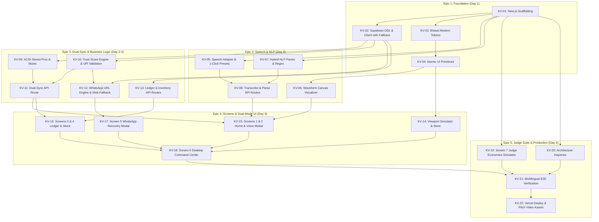

# KhataVoice: Master Engineering Backlog & BEADS Ticket Directory

Welcome to the master engineering backlog for **KhataVoice** (Next Founders Hackathon, Devpost).

This directory decomposes the entire architectural, UI, API, database, and business specification across the 18 canonical documentation files in [`Docs/`](file:///c:/CCodes_WebDevelopment/hckthon/Next%20Founders/Docs) into **22 granular, contract-driven engineering tickets**.

Every ticket follows the **BEADS (Behavior-Driven Agent Design System)** framework and embeds the security, concurrency, and usability hardening discovered during **Council Review (DMAD V2)** and **Adversarial Review (Red Team Attack)**.

---

## 1. Backlog Summary & Sprint Metrics

- **Total Epics:** 5
- **Total Tickets:** 22
- **Estimated Total Story Points:** 78 SP
- **Target Sprint Window:** 4 Days (Deadline: Oct 16, 2026 @ 2:30 AM IST)
- **Primary Judge:** Ekansh Jain (Co-Founder, LUMA Youth)
- **Evaluation Rubric:** Technical Execution (25%), Innovation & UX (25%), Business & Finance (25%), Communication & Video (25%)

| Epic | Description | Ticket Count | Story Points | Target Milestone |
| :--- | :--- | :---: | :---: | :--- |
| **Epic 1: Foundation & Design System** | Next.js scaffold, Supabase schema & client, Bharat Modern tokens, atomic UI primitives | 4 | 13 SP | Day 1 |
| **Epic 2: Multilingual Speech & NLP Engine** | Tri-tier speech adapter, waveform canvas, hybrid NLP parser, API routes | 4 | 16 SP | Day 2 |
| **Epic 3: Atomic Dual-Sync & Business Logic** | ACID dual-sync stored procedure, Trust Score math, dual-sync route, WhatsApp engine, ledger/stock APIs | 5 | 18 SP | Day 2–3 |
| **Epic 4: Dual-Mode Screens & UI Workflows** | Viewport simulator, Screens 1–5 (Mobile), Screen 6 (Desktop Command Center) | 5 | 17 SP | Day 3 |
| **Epic 5: Judge Suite, Testing & Launch** | Screen 7 (Judge Economics), Architecture Inspector, E2E Multilingual testing, Vercel deployment | 4 | 14 SP | Day 4 |

---

## 2. Master Execution Dependency DAG

---

## 3. Complete Ticket Index & Mapping

| Ticket ID | Ticket Title | Priority | SP | Depends On | Unblocks |
| :--- | :--- | :---: | :---: | :--- | :--- |
| [KV-01](file:///c:/CCodes_WebDevelopment/hckthon/Next%20Founders/Docs/Tickets/KV-01-scaffold-nextjs-app.md) | Scaffold Next.js 14/15 App Router Application & Directory Structure | P0 | 3 | None | KV-02, KV-03, KV-05, KV-07, KV-19, KV-20 |
| [KV-02](file:///c:/CCodes_WebDevelopment/hckthon/Next%20Founders/Docs/Tickets/KV-02-supabase-ddl-and-client.md) | Supabase Cloud PostgreSQL Schema, RLS, & Local In-Memory Fallback Client | P0 | 4 | KV-01 | KV-09, KV-10, KV-12, KV-13 |
| [KV-03](file:///c:/CCodes_WebDevelopment/hckthon/Next%20Founders/Docs/Tickets/KV-03-bharat-modern-design-tokens.md) | Implement "Bharat Modern" Fintech Design Tokens & CSS Reset | P0 | 2 | KV-01 | KV-04 |
| [KV-04](file:///c:/CCodes_WebDevelopment/hckthon/Next%20Founders/Docs/Tickets/KV-04-atomic-ui-primitives.md) | Atomic UI Design System Primitives (Buttons, Badges, Modals, Cards) | P0 | 4 | KV-03 | KV-06, KV-14 |
| [KV-05](file:///c:/CCodes_WebDevelopment/hckthon/Next%20Founders/Docs/Tickets/KV-05-tri-tier-speech-adapter.md) | Tri-Tier Speech Recognition Adapter with 1-Click Audio Sample Presets | P0 | 5 | KV-01 | KV-08 |
| [KV-06](file:///c:/CCodes_WebDevelopment/hckthon/Next%20Founders/Docs/Tickets/KV-06-waveform-visualizer-canvas.md) | Real-Time Audio Waveform Canvas Visualizer with Strict Lifecycle Cleanup | P1 | 3 | KV-04 | KV-15 |
| [KV-07](file:///c:/CCodes_WebDevelopment/hckthon/Next%20Founders/Docs/Tickets/KV-07-hybrid-nlp-transaction-parser.md) | Hybrid NLP Transaction Parser (Ollama / Gemini + Zero-Key Regex Fallback) | P0 | 5 | KV-01 | KV-08 |
| [KV-08](file:///c:/CCodes_WebDevelopment/hckthon/Next%20Founders/Docs/Tickets/KV-08-transcribe-and-parse-api-routes.md) | Route Handlers `POST /api/transcribe` & `POST /api/parse-transaction` | P0 | 3 | KV-05, KV-07 | KV-15 |
| [KV-09](file:///c:/CCodes_WebDevelopment/hckthon/Next%20Founders/Docs/Tickets/KV-09-supabase-acid-stored-procedure.md) | PostgreSQL ACID Stored Procedure `execute_spoken_dual_sync` & Overdraft Alert | P0 | 4 | KV-02 | KV-11 |
| [KV-10](file:///c:/CCodes_WebDevelopment/hckthon/Next%20Founders/Docs/Tickets/KV-10-kirana-trust-score-engine.md) | Kirana Credit Trust Score Engine (0-100) & Strict RFC UPI Parameter Validator | P0 | 3 | KV-02 | KV-11, KV-12 |
| [KV-11](file:///c:/CCodes_WebDevelopment/hckthon/Next%20Founders/Docs/Tickets/KV-11-dual-sync-api-route.md) | Route Handler `POST /api/dual-sync` with Concurrency Mutex Lock | P0 | 4 | KV-09, KV-10 | KV-15, KV-16 |
| [KV-12](file:///c:/CCodes_WebDevelopment/hckthon/Next%20Founders/Docs/Tickets/KV-12-cultural-whatsapp-reminder-engine.md) | Multilingual WhatsApp Reminder Engine (`wa.me`, Desktop Web Fallback & 1-Tap Copy) | P0 | 4 | KV-02, KV-10 | KV-17 |
| [KV-13](file:///c:/CCodes_WebDevelopment/hckthon/Next%20Founders/Docs/Tickets/KV-13-ledger-and-inventory-api-routes.md) | Route Handlers `GET /api/ledger`, `GET /api/inventory`, & `GET /api/customers` | P1 | 3 | KV-02 | KV-16 |
| [KV-14](file:///c:/CCodes_WebDevelopment/hckthon/Next%20Founders/Docs/Tickets/KV-14-dual-mode-viewport-simulator.md) | Dual-Mode Viewport Simulator (Mobile Handset vs. Desktop Command Center) | P0 | 3 | KV-04 | KV-18 |
| [KV-15](file:///c:/CCodes_WebDevelopment/hckthon/Next%20Founders/Docs/Tickets/KV-15-screen-1-and-2-home-voice-modal.md) | Screens 1 & 2: Kirana Mobile Home & Voice Modal with 4s Countdown & Soundbox TTS | P0 | 5 | KV-06, KV-08, KV-11 | KV-18 |
| [KV-16](file:///c:/CCodes_WebDevelopment/hckthon/Next%20Founders/Docs/Tickets/KV-16-screen-3-and-4-ledger-and-inventory.md) | Screens 3 & 4: Udhaar Credit Ledger & Real-Time Inventory Stock Views | P0 | 4 | KV-11, KV-13 | KV-18 |
| [KV-17](file:///c:/CCodes_WebDevelopment/hckthon/Next%20Founders/Docs/Tickets/KV-17-screen-5-whatsapp-recovery-modal.md) | Screen 5: Cultural WhatsApp Debt Recovery Modal with 3 Tones & 1-Tap Launch | P0 | 3 | KV-12 | KV-18 |
| [KV-18](file:///c:/CCodes_WebDevelopment/hckthon/Next%20Founders/Docs/Tickets/KV-18-screen-6-desktop-command-center.md) | Screen 6: Desktop Merchant Command Center with Live Supabase Realtime Stream | P0 | 4 | KV-14, KV-15, KV-16, KV-17 | KV-21 |
| [KV-19](file:///c:/CCodes_WebDevelopment/hckthon/Next%20Founders/Docs/Tickets/KV-19-screen-7-judge-economics-simulator.md) | Screen 7: Judge Economics & Working Capital ROI Simulator (Ekansh Jain Rubric) | P0 | 4 | KV-01 | KV-21 |
| [KV-20](file:///c:/CCodes_WebDevelopment/hckthon/Next%20Founders/Docs/Tickets/KV-20-architecture-scalability-inspector.md) | Architecture & Scalability Inspector Tab with Topology Visualizer & Fallback Matrix | P1 | 3 | KV-01 | KV-21 |
| [KV-21](file:///c:/CCodes_WebDevelopment/hckthon/Next%20Founders/Docs/Tickets/KV-21-end-to-end-multilingual-verification.md) | End-to-End Multilingual Verification Suite (Bengali, Hindi, Hinglish, English) | P0 | 4 | KV-18, KV-19, KV-20 | KV-22 |
| [KV-22](file:///c:/CCodes_WebDevelopment/hckthon/Next%20Founders/Docs/Tickets/KV-22-production-deployment-and-pitch-assets.md) | Production Vercel Deployment, Video Pitch Assets, & Demo Rehearsal Checklist | P0 | 3 | KV-21 | Complete |

---

## 4. Adversarial & Council Invariants Cross-Reference

Before marking any ticket complete, ensure the following critical invariants are satisfied:

1. **Concurrency Mutex (`KV-09`, `KV-11`, `KV-15`):** 4-second auto-commit timer locks user input against duplicate submits. Server-side transaction ensures idempotent increments.
2. **WhatsApp Web Desktop Fallback (`KV-12`, `KV-17`):** Desktop users must get a 1-tap clipboard copy button and automatic `web.whatsapp.com` redirect.
3. **Strict RFC 3986 UPI Encoding (`KV-10`, `KV-12`):** Store and customer names must be encoded safely without breaking mobile UPI intent handlers.
4. **Non-Blocking Negative Inventory (`KV-09`, `KV-11`):** Selling items when recorded stock is low emits an amber warning badge but does not crash the sale.
5. **Canvas Lifecycle Cleanup (`KV-06`):** Audio context and animation frame loops must be cleanly canceled in `useEffect` unmount.
6. **Soundbox Vernacular Confirmation (`KV-15`):** Successful dual-sync commits must play a confirmation chime and trigger speech synthesis in the active vernacular.
7. **Zero-Config Local Fallback (`KV-02`, `KV-05`, `KV-07`, `KV-09`):** Application runs 100% locally out-of-the-box without crashing if Supabase or AI keys are absent.
