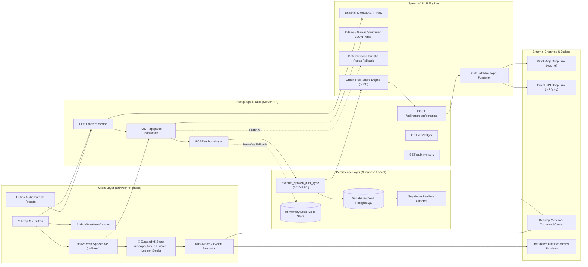
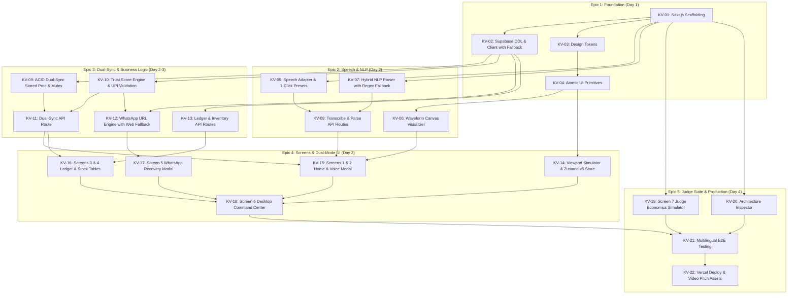
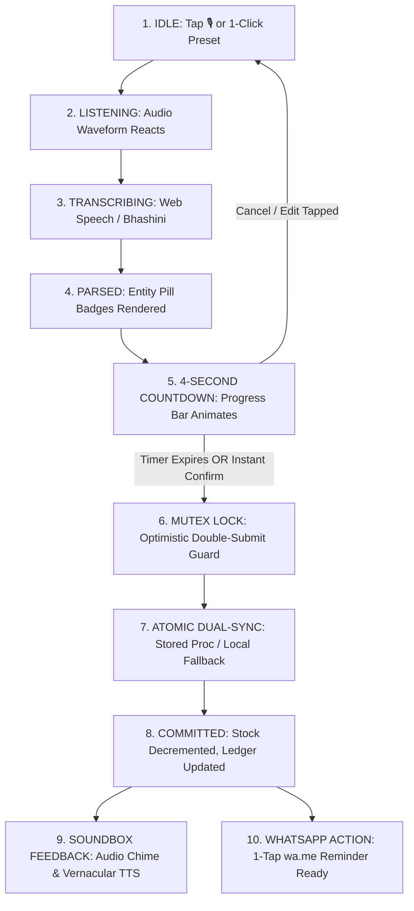
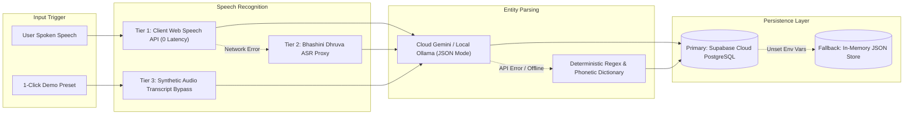

# KhataVoice: Visual Architecture & Knowledge Graphs (graphify)

This document visualizes the complete architectural topology, data pipelines, state machines, and ticket execution dependencies for **KhataVoice** generated via `/graphify`.

---

## 1. End-to-End System Topology & Data Pipeline

---

## 2. BEADS 22-Ticket Dependency DAG (Execution Cartography)

---

## 3. Spoken Transaction Lifecycle & Concurrency Mutex State Machine

---

## 4. Zero-Config Multi-Tier Fallback Pipeline

