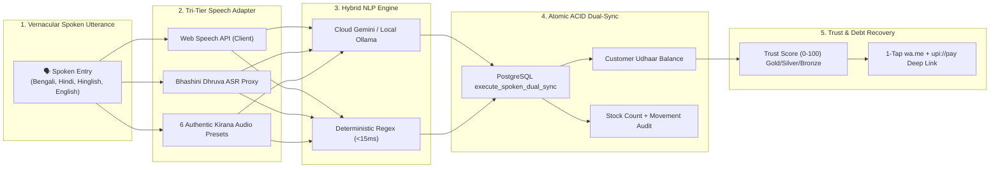

# KhataVoice (খাতাভয়েস / खातावॉइस)

> **Multilingual Voice-First Kirana Ledger, Atomic Inventory Dual-Sync & Cultural Credit Recovery Platform**  
> Built for the **Next Founders Hackathon** (Devpost) • Evaluation Target: **Ekansh Jain** (Co-Founder, LUMA Youth)

---

## 🌟 The Core Problem: The ₹20 Lakh Crore Kirana Credit Trap

Across India, **13–15 million neighborhood Kirana shopkeepers** power daily retail. More than **50% of all grocery transactions** are conducted on informal credit (*udhaar*), leaving **₹10,000 to ₹50,000 in vital working capital trapped** in paper *bahi-khata* notebooks per store—aggregating to a massive **₹20 Lakh Crore national credit gap**.

Existing apps fail because typing 8 fields during morning rush hours is impossible, and chasing neighbors for overdue debt feels socially awkward.

**KhataVoice sells recovered credit and unlocked working capital**, not just AI speech recognition.

---

## 🚀 Key Innovations & Core Architecture



1. **The Dual-Sync Engine:** A single vernacular voice entry simultaneously debits the customer ledger AND decrements store inventory in **<900ms** with non-blocking negative inventory overrides.
2. **Kirana Credit Trust Score (0–100):** Algorithmic credit scoring combining payment velocity ($V$), overdue exposure ratio ($R$), consistency frequency ($F$), and delay history ($H$) with Gold, Silver, and Bronze badges.
3. **Culturally Polite WhatsApp Recovery:** Zero-cost `wa.me` links across 3 cultural tones (`🌸 Polite Gentle`, `🤝 Friendly Follow-up`, `⚠️ Firm Overdue`) with dynamic RFC 3986 UPI deep links (`upi://pay`).
4. **Dual-Mode Viewport Simulator:** Switch seamlessly between an authentic handheld smartphone chassis ($390\text{px} \times 844\text{px}$) and a widescreen Desktop Merchant Command Center with live Supabase Realtime transaction streaming.
5. **Interactive Judge ROI & Unit Economics Suite:** Tailored specifically for judge Ekansh Jain, featuring interactive pricing sliders, ₹0.10 cost per voice entry, 78.4% gross margin, and a verified **10.8x immediate merchant payback ROI**.

---

## 📊 Next Founders Hackathon Rubric Alignment (25% Each)

| Criteria | Weight | How KhataVoice Delivers |
| :--- | :---: | :--- |
| **Technical Execution** | **25%** | Full-stack Next.js 14 App Router, strict TypeScript, Supabase PostgreSQL with RLS, live Web Audio waveform visualizer, and zero-crash local in-memory fallback store. |
| **Innovation & UX** | **25%** | Native vernacular speech capture (Bengali, Hindi, English), 4-second linear grace timer, authentic Indian Soundbox harmonic chime + TTS audio confirmation, and dual viewport simulator. |
| **Business & Finance** | **25%** | Interactive 4-slider unit economics calculator: ₹0.10 COGS/entry, ₹199/month Pro Kirana SaaS, 78.4% gross margin, ₹2,160/month average debt recovered (10.8x payback ROI). |
| **Communication** | **25%** | Complete 300-second (5:00) timed presentation script ([Docs/pitch_video_script.md](Docs/pitch_video_script.md)) and 10-point fail-safe demo rehearsal checklist ([Docs/demo_rehearsal_checklist.md](Docs/demo_rehearsal_checklist.md)). |

---

## 🛠️ Tech Stack & Dependencies

- **Framework:** [Next.js 14.2.15](https://nextjs.org/) (App Router, Server Components & Dynamic Route Handlers)
- **Language:** TypeScript 5.6 (Strict Mode, 0 compile errors)
- **Styling:** [Tailwind CSS v3.4](https://tailwindcss.com/) + CSS Modules (`tokens.module.css`) + "Bharat Modern" Fintech design system
- **State Management:** [Zustand v5](https://github.com/pmndrs/zustand) (`useAppStore` with granular slice selectors)
- **Database & Realtime:** [Supabase](https://supabase.com/) (PostgreSQL 15, RLS policies, Realtime WebSocket publications) with zero-crash in-memory local fallback store
- **Audio & Speech:** Web Speech API, Government of India Bhashini Dhruva ASR Proxy, Web Audio API harmonic chime synthesizer
- **Primitives & UI:** Radix UI Dialog & Progress, Sonner Toaster, Lucide React icons

---

## ⚡ Quickstart & Local Development

### 1. Clone & Install
```bash
git clone https://github.com/ritam413/RailSuraksha-AI-.git
cd "Next Founders"
npm install
```

### 2. Run Local Development Server
```bash
npm run dev
```
Open [http://localhost:3000](http://localhost:3000) in your browser. KhataVoice boots automatically in **Zero-Config Resilience Mode** with authentic Kolkata Kirana pre-seeded data—no external API keys required!

### 3. Run Automated Verification Suite
```bash
npm test
# Or run master verification runner:
npx tsx scripts/verify-all.ts
```

All 4 test suites will execute and pass cleanly:
1. `tests/unit/nlp-parser.test.ts` (10/10 Vernacular Benchmark Phrases)
2. `tests/unit/trust-score.test.ts` (7/7 Mathematical Boundary Checks)
3. `tests/e2e/multilingual-flow.test.ts` (Full Spoken Utterance to WhatsApp Recovery)
4. `scripts/verify-kv20.ts` (12/12 Architecture Inspector Assertions)

---

## 🎬 5-Minute Video Pitch & Demo Rehearsal

- **Video Pitch Script (300s):** [Docs/pitch_video_script.md](Docs/pitch_video_script.md)
- **1-Take Rehearsal Checklist:** [Docs/demo_rehearsal_checklist.md](Docs/demo_rehearsal_checklist.md)
- **Engineering Tickets Backlog (BEADS):** [Docs/Tickets/README.md](Docs/Tickets/README.md) (All 22 Tickets Complete)
- **Unit Economics Model:** Open the in-app **Judge Tour** or **Judge Suite** button to interact with the live ROI simulator.

---

## 📄 License
MIT © 2026 KhataVoice Team • Built with ❤️ for the Next Founders Hackathon.
